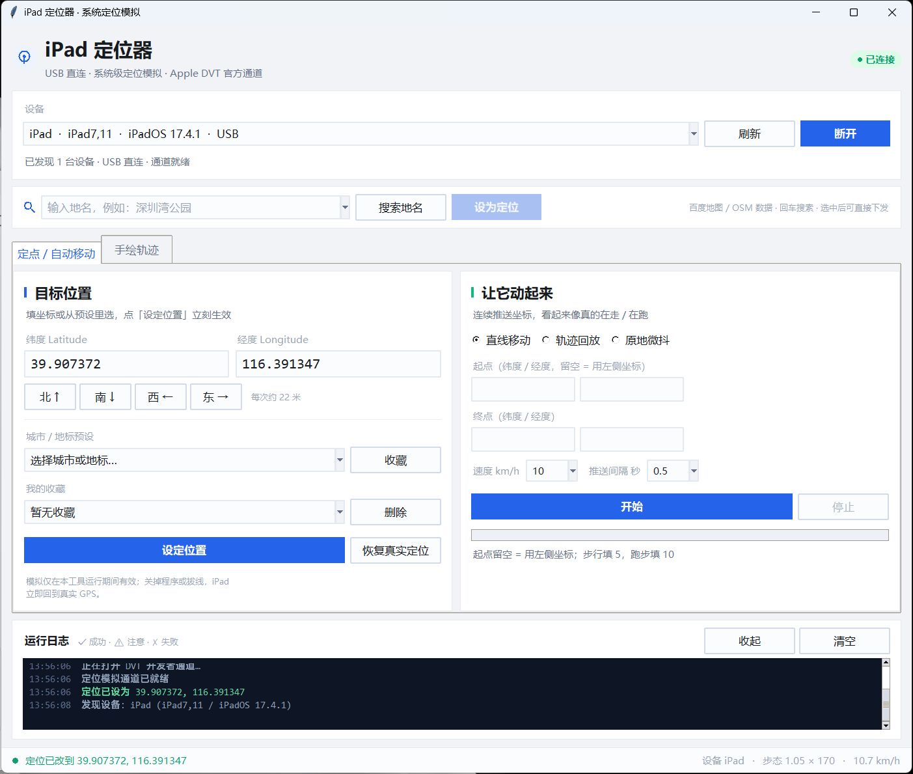
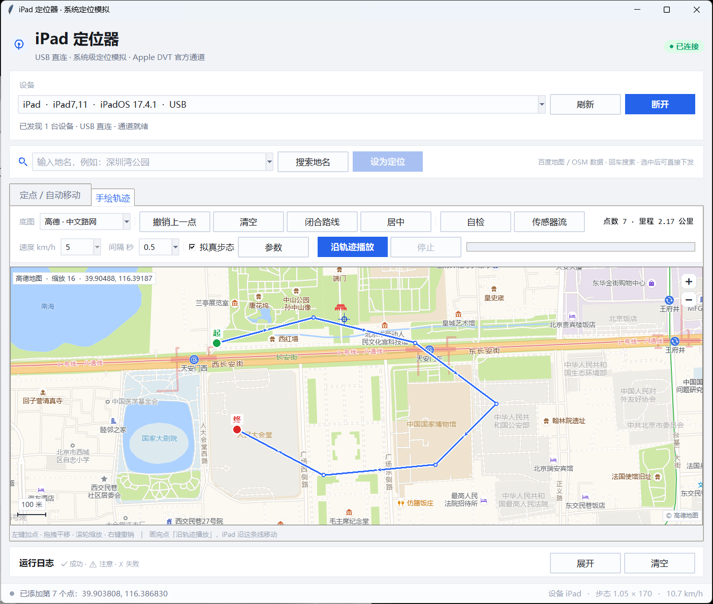
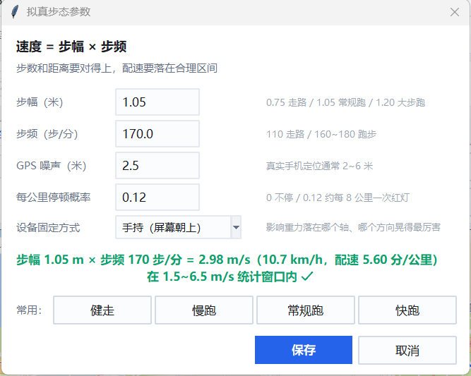
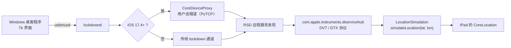

# iPad 定位器 · Windows 桌面版

> 一根数据线连上 iPad / iPhone，把**系统级定位**改到任意坐标；也可以在地图上**手绘一条路线**，让它沿着这条线跑起来。


走的是 Apple 官方 **DVT 开发者通道**（`com.apple.instruments.dtservicehub` → `simulateLocation`），
和 Xcode 的 `Debug → Simulate Location` 是同一条路：**不越狱、不装描述文件、不开 VPN**，
对 App 来说这就是真实 GPS。



---

## 它和别的方案有什么不一样

| | 本工具 | LocationSpoofer（Android） | Xcode Simulate Location |
|---|---|---|---|
| 设备要求 | iPad / iPhone，插线即可 | 需要 Android + 开发者选项 | 需要 Mac + Xcode |
| 越狱 / Root | 不需要 | 不需要（模拟位置） | 不需要 |
| 手绘轨迹 | ✅ 电脑上鼠标画 | ✅ 手机屏幕上画 | ❌ 只能改点 |
| 地名搜索 | ✅ 百度 / OSM | ✅ Google | ❌ |
| 拟真步态 | ✅ 步幅×步频 + 噪声 + 停顿 | ❌ | ❌ |
| 批量 / 脚本 | ✅ 自带 CLI | ❌ | ❌ |

---

## 三步跑起来

```text
1. 装环境     安装 Python 3.10+（勾选 Add to PATH），然后：
              pip install -r requirements.txt

2. 连设备     数据线插电脑 → iPad 点「信任」
              iOS 16+ 还要开：设置 → 隐私与安全性 → 开发者模式 → 重启

3. 双击       启动.cmd
```

首次启动约 1 秒连上，之后每次改坐标 **20~30 毫秒**生效。

> 完整图文步骤（含每个界面的说明、20 条报错对照）见 **[教程.md](教程.md)**。

---

## 环境要求

| 项 | 要求 |
|---|---|
| 系统 | Windows 10 / 11（64 位） |
| Python | 3.10 及以上，**必须带 tkinter**（python.org 官方安装包自带） |
| 依赖 | `pymobiledevice3` / `Pillow` / `requests` |
| 驱动 | iTunes 或「Apple 设备」已安装（提供 `Apple Mobile Device Service`） |
| 设备 | iPad / iPhone，**能传数据的线**；iOS 16+ 需开启开发者模式 |
| 权限 | 不需要管理员（iOS 17.4+ 走免 root 用户态隧道） |

已实测：**iPad7,11 / iPadOS 17.4.1 / USB**。
iOS 17.4 以下会退回传统 lockdown 通道（代码里保留分支，未逐一实测）。

---

## 四个核心用法

### 1. 定点

填经纬度，或从 60 个城市地标里选，点「设定位置」。
`北 ↑ 南 ↓ 西 ← 东 →` 每次微调约 22 米，用来挪到具体门牌。

### 2. 手绘轨迹（推荐）



左键在地图上连续点出路线 → 右键撤销 → 拖拽平移、滚轮或右上角 `+ / −` 缩放 →
选速度 → **沿轨迹播放**。

点与点之间会按总长度自动插值，设备走的是平滑的线，不是"跳点"。
需要绕操场就点「闭合路线」，终点自动连回起点。

### 3. 导入现成路线

工具栏点 **导入路线**，支持四种：

| 文件 | 说明 |
|---|---|
| `.gpx` | 手表 / 运动 App 导出的标准轨迹 |
| `.csv` | 两列 `纬度,经度` |
| `.json`（LocationSpoofer 导出） | `savedRoutes` 格式，多条路线会弹窗让你选 |
| GeoJSON | `LineString` / `FeatureCollection` |

导入时会问一次**坐标系**（WGS84 / GCJ-02 / BD-09）——选错会整体偏 300~600 米。
LocationSpoofer 的文件默认按 GCJ-02 处理。导入后自动居中、自动存一份到 `tracks/`，
下次打开程序还会自动铺回地图。

> 实测：同一个存档按 WGS84 直接读，离真实操场 506 米；按 GCJ-02 换算后离 POI 只有 3 米。

### 4. 拟真步态



勾上「拟真步态」后，速度不再是你填的常数，而是由 **步幅 × 步频** 推出来的：

```
速度(m/s) = 步幅(m) × 步频(步/分) ÷ 60
```

上报的每个点再叠五层真实特征：

| 特征 | 做法 |
|---|---|
| 步态波动 | 每两步一个周期、±5% 瞬时速度起伏（左右脚不对称） |
| 后程掉速 | 跑过 65% 后缓慢掉 3%，最后 5% 再冲一下 |
| 随机停顿 | 按「每公里概率」触发 6~20 秒停顿（等红灯），期间坐标不动 |
| GPS 漂移 | AR(1) 相关噪声（上一次误差 85% 延续），像真实定位缓慢游走，而不是白噪声抖动 |
| 窗口约束 | 静态速度留 5% 余量落在 `1.5~6.5 m/s`，否则一波动就掉出计费窗口 |

四档预设：

| 预设 | 步幅 × 步频 | 速度 | 配速 |
|---|---|---|---|
| 健走 | 0.78 × 118 | 1.53 m/s | 10:53 /km |
| 慢跑 | 0.95 × 155 | 2.45 m/s | 6:47 /km |
| 常规跑 | 1.05 × 170 | 2.98 m/s | 5:36 /km |
| 快跑 | 1.18 × 182 | 3.58 m/s | 4:39 /km |

> 「健走」这一档只比 1.5 m/s 下限高一点点，一波动就有约 40% 的区间掉出窗口、那一段不计里程。
> 想稳，配速放在 **2.0 ~ 5.5 m/s** 之间。

**「自检」按钮**会用和真跑完全相同的生成器（同一个随机种子）先把轨迹跑一遍，输出速度分布、
区间命中率、瞬移点数、步数与距离是否自洽——这些数字是算出来的，不是写死的。

---

## 地名搜索

设备卡下面那条搜索栏，两个页签共用。输入地名 → 回车 → 选中候选 → 「设为定位」直接下发。

三级兜底：

| 顺序 | 来源 | 需要 AK | 坐标系 |
|---|---|---|---|
| 1 | 百度地图官方地点检索 API | 需要（填写见下） | BD-09 |
| 2 | 百度地图 Web 检索接口 | 不需要 | BD09MC |
| 3 | Photon（OSM 数据） | 不需要 | WGS84 |

想用官方接口（更稳、有配额）：去 [百度地图开放平台](https://lbsyun.baidu.com/) 建一个「服务端」应用，
把 AK 填进 `settings.json` 的 `baidu_ak`，或设环境变量 `BAIDU_AK`。不填也能用，走第 2 条。

---

## 坐标系：为什么这一步不能省

| 底图 | 坐标系 | 说明 |
|---|---|---|
| 高德 · 中文路网 | GCJ-02 | 中文街道名，好认路；程序内部换成 WGS84 再下发 |
| Esri · 卫星图 | WGS84 | 真实影像，和 iPad 完全一致，定门牌最准 |
| Esri · 英文路网 | WGS84 | 路网 + 英文标注 |

国内地图用 GCJ-02（火星坐标），百度又在其上叠了 BD-09，和真实 GPS 的 WGS84 差 300~600 米。
直接把地图上量到的经纬度发给 iPad 会**偏一条街**。

`geo.py` 实现了 `WGS84 ↔ GCJ-02 ↔ BD-09 ↔ BD09MC` 全链换算，其中 BD09MC 那张 6 段多项式系数表
是从百度 JS 里移植的——第三方库通常只做到 BD-09，拿不到墨卡托米。

实测校验：百度搜「天安门」得 `116.391347, 39.907372`，OSM 同一地点 `116.391263, 39.907359`，
**差不到 1 米**。

导入外部轨迹时同理：程序会让你选文件原本的坐标系（WGS84 / GCJ-02 / BD-09），
选完统一换算成 WGS84 再下发，所以底线图是哪个都不会偏。

> 底图为什么不用百度：它的瓦片接口要签名，匿名请求只返回 210 字节占位图。
> 所以底图用高德 / Esri，**搜索走百度**——两边各用最强的部分。

---

## 工作原理



最小可用代码：

```python
from pymobiledevice3.remote.userspace_tunnel import UserspaceRsdTunnel
from pymobiledevice3.services.dvt.instruments.dvt_provider import DvtProvider
from pymobiledevice3.services.dvt.instruments.location_simulation import LocationSimulation

async with UserspaceRsdTunnel(serial=udid) as rsd:
    async with DvtProvider(rsd) as dvt, LocationSimulation(dvt) as loc:
        await loc.set(39.908722, 116.397499)   # 单次 20~30 ms
        await loc.clear()                      # 撤销，回到真实定位
```

**模拟是会话级的**：关程序、拔线、点「恢复真实定位」都会立刻回到真实 GPS，不会残留。

---

## 命令行

适合写脚本、做定时任务：

```bat
python cli.py list                                   :: 列出设备
python cli.py set 39.908722 116.397499               :: 设坐标并保持（Ctrl+C 结束）
python cli.py set 39.908722 116.397499 --hold 600    :: 保持 600 秒后自动撤销
python cli.py walk 39.9087 116.3975 39.9170 116.3975 --speed 10
python cli.py gait 36.5579 116.8117 36.5598 116.8112 --stride 1.05 --cadence 170 --noise 2.5
python cli.py track route.gpx --interval 1
python cli.py clear                                  :: 恢复真实定位
```

---

## 目录结构

```text
ipad-locator/
├─ 启动.cmd              双击启动 GUI（自动找 pythonw）
├─ 诊断.cmd              环境自检 + 链路测试
├─ 打包exe.cmd           用 PyInstaller 打成单文件 exe
├─ main.py               入口
├─ gui.py                界面（搜索栏 + 两个页签 + 状态栏 + 拟真参数）
├─ map.py                可手绘的地图控件（Canvas + 在线瓦片 + 缩放/平移/适配）
├─ geo.py                WGS84 / GCJ-02 / BD-09 / BD09MC 坐标换算
├─ search.py             地名搜索（百度 AK → 百度 Web → Photon 三级兜底）
├─ core.py               设备会话 / 隧道 / 定位会话 / 移动引擎 / 拟真步态 / GPX·CSV 解析
├─ cli.py                命令行版
├─ cities.py             60 个城市地标坐标
├─ sensor_gen.py         按轨迹+步态生成 IMU 流（加速度 / 陀螺仪，50 Hz）
├─ sensor_push.py        通过 AFC 把数据流推到设备 /var/mobile/Media/
├─ sensor_spoof/         越狱注入插件源码（hook CoreMotion，需自行编译验证）
├─ selftest.py           链路自测（连设备 → 设坐标 → 撤销）
├─ walktest.py           移动引擎自测
├─ docs/                 截图
├─ tracks/               保存的路线（导入/保存自动写入）
├─ settings.example.json 配置模板（收藏 / 步态 / 百度 AK）
└─ requirements.txt
```

运行后会自己生成 `settings.json`、`sensorspoof.json`、`tiles/`，都已加进 `.gitignore`。

---

## 能做到什么，做不到什么

这一节尽量说实话，避免你浪费时间在不可能的方向上。

| 检测项 | 本工具 |
|---|---|
| 区间速度（`haversine / Δt`） | ✅ 拟真步态把速度曲线做进 `1.5~6.5 m/s` |
| 距离 ÷ 步数是否自洽 | ✅ 步数由步幅与位移同时推导，三者对得上 |
| 轨迹形态（有无瞬移、是否沿路网） | ✅ 插值推进 + 相关噪声，无瞬移 |
| WiFi / 基站列表 | ➖ **iOS 上不存在这个伪造点**：系统不给 App 读基站（`CoreTelephony` 只有运营商名），小程序那套 `wifiInfo[]` 采集只在 Android 生效 |
| 陀螺仪 / 加速度 | ⚠️ 电脑侧无写入通道：枚举设备 59 个 RSD 服务，与会话相关的 0 个；诊断服务只读。**只能越狱 hook**，`sensor_spoof/` 给了源码但未编译验证 |
| 越狱环境检测 | ❌ 为了补传感器去越狱，会立起更大的红旗，通常得不偿失 |

结论：**轨迹侧可以做得像，传感器侧接受它是短板。**

---

## 常见问题（速查）

| 症状 | 处理 |
|---|---|
| 界面文字发虚 | 程序已声明 DPI 感知；若仍模糊，确认没被系统「兼容性 → 替代高 DPI 缩放」覆盖 |
| `usbmux list` 输出 `[]` | 换数据线；解锁设备点「信任」；确认 `Apple Mobile Device Service` 在跑 |
| 提示开发者模式未开启 | 设置 → 隐私与安全性 → 开发者模式 → 开 → 重启设备 |
| 卡在「正在建立免 root 隧道」 | 首次要拉起 PyTCP，1~3 秒正常；超 30 秒就换 USB 口（避开前面板 hub）、放行防火墙 |
| 坐标设了但地图 App 没动 | 杀掉 App 重开；「查找」显示的是 Apple 服务端位置，不是本机模拟值 |
| 地图一片灰格 | 瓦片被网络拦；切「Esri · 卫星图」试 |
| 一直显示「正在加载地图瓦片…」 | 代理/VPN 时通时不通；程序会自动切直连并重试 3 次 |
| 搜出来偏几百米 | 看结果标记：`[OSM]` 说明退到了第三级，换更具体的名字或填百度 AK |

完整排查流程见 [教程.md 第 8 节](教程.md)。

---

## 安卓怎么办（这套工具只服务 iOS）

安卓不走这个工具，但也别急着刷机 —— 按需求选，代价差别很大：

| 你实际需要的 | 该做什么 | 代价 |
|---|---|---|
| 只改定位 / 跑轨迹 | 开发者选项 → 选一个「模拟位置信息应用」，用模拟位置 App | 几乎为零；但 `isFromMockProvider` 会露 |
| 连 `isFromMockProvider` 也要过 | Root + LSPosed hook `LocationManager` | 解 BL 锁（清数据）、掉 Play Integrity |
| 还要伪造 WiFi / 基站列表 | 同上 + 接管 `WifiManager` / 扫描结果的模块 | 痕迹更多，要靠隐藏模块对冲 |
| 还要伪造陀螺仪 / 加速度 | 只能 hook 传感器，且数据要自己合成 | 投入产出比最差，通常不建议 |

完整路线在 **[教程.md 第 12、13 节](教程.md#12-安卓root-之后把环境藏干净)**：

- **要藏什么**：`isFromMockProvider`、Xposed 特征、root 痕迹、应用列表、系统完整性、系统属性 —— 六个检测点逐条对照
- **怎么藏**：`悲伤一键隐藏环境`（模块 id `bszip`，支持 Magisk / KernelSU / APatch）的装法与六条配置纪律
- **为什么隐藏必须放最后**：每装一个模块都会改包列表与挂载点，先藏再装等于白藏
- **藏完怎么自测**：8 项验收清单（含冷启动复测）
- **藏好了还被判无效**：那是轨迹问题不是环境问题，怎么区分、怎么补

一句话：**只有定位需求就别刷机**；这条 iOS 路线的价值正是"零痕迹地做到 L1 做不到的事"。

---

## 许可与声明

本目录代码随本仓库以 **GPL-3.0** 发布，见仓库根目录 `LICENSE-GPL-3.0.txt`。

本项目仅用于**自己设备上的开发调试、自动化测试与学习研究**（例如测试自己的 App 在异地定位下的表现）。
把它用于考勤、打卡、竞赛等场景可能违反你所在平台或学校的规则，后果由使用者自行承担。
作者不提供任何规避第三方检测的保证，也不对使用后果负责。
