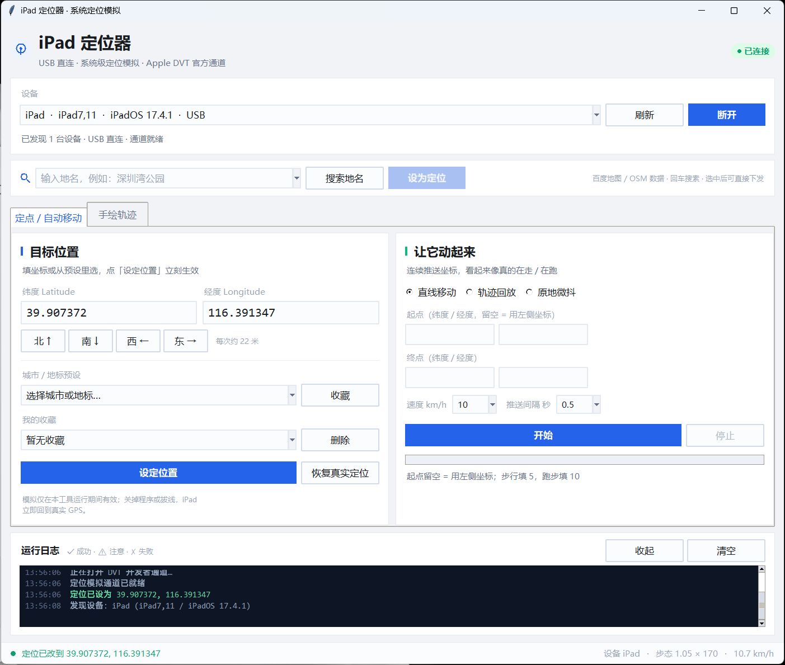
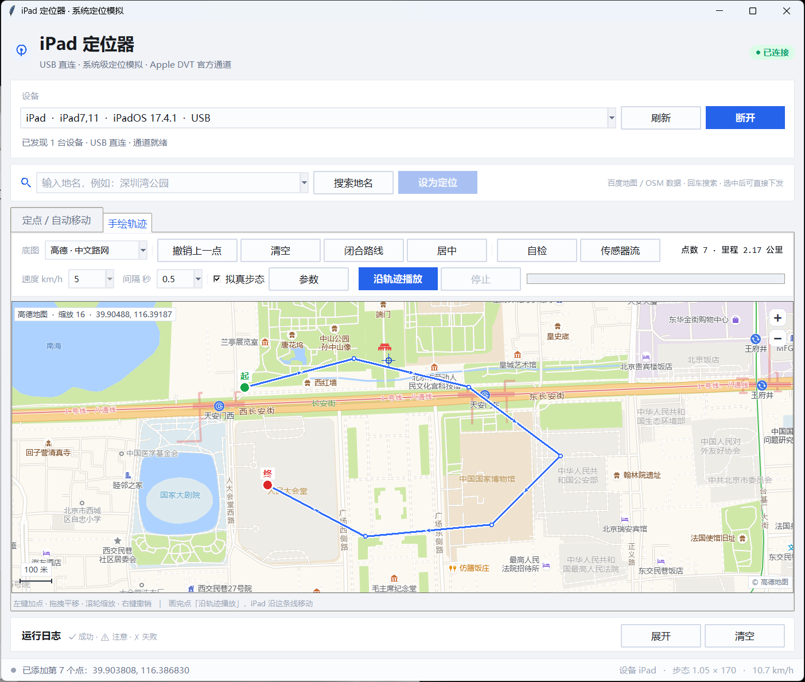
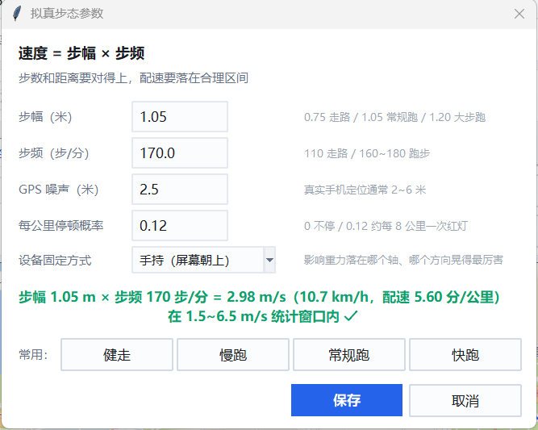

# 从零开始：iPad 定位模拟器 使用教程

> 写给第一次用的人。全程照着做，大约 **15 分钟**能跑通第一条轨迹。
> 已经在用的人可以直接跳到 [第 4 节](#4-场景二手绘一条轨迹并播放核心用法) 或 [第 8 节](#8-出错了怎么办) 排查。

---

## 目录

- [0. 先花两分钟搞清楚它是什么](#0-先花两分钟搞清楚它是什么)
- [1. 准备工作（约 15 分钟）](#1-准备工作约-15-分钟)
- [2. 第一次启动：界面导览](#2-第一次启动界面导览)
- [3. 场景一：定一个点](#3-场景一定一个点)
- [4. 场景二：手绘一条轨迹并播放（核心用法）](#4-场景二手绘一条轨迹并播放核心用法)
- [5. 场景三：拟真步态怎么填参数](#5-场景三拟真步态怎么填参数)
- [6. 场景四：搜地名直接定位](#6-场景四搜地名直接定位)
- [7. 场景五：命令行与定时任务](#7-场景五命令行与定时任务)
- [8. 出错了怎么办](#8-出错了怎么办)
- [9. 收尾：恢复真实定位与清理](#9-收尾恢复真实定位与清理)
- [10. 想改代码：模块地图](#10-想改代码模块地图)
- [11. 它能做到哪一步](#11-它能做到哪一步)

---

## 0. 先花两分钟搞清楚它是什么

### 它能做三件事

1. **把 iPad 的系统定位改到任意坐标**（不是某个 App 里的"虚拟位置"，是全系统生效）
2. **在地图上用鼠标画一条线，让它沿着这条线跑**，速度、配速、步数都能对得上
3. **按地名搜索**，搜到就直接跳过去，不用手查经纬度

### 三条必须先知道的前提

| 前提 | 说明 |
|---|---|
| **必须插数据线** | 走 USB，不走 Wi-Fi（Wi-Fi 需要另外的 tunneld 模式，本工具默认不开） |
| **程序得开着** | 模拟是"会话级"的：关程序、拔线、点恢复，设备立刻回真实 GPS |
| **不能锁屏太久** | 设备休眠后 USB 通道可能断，建议「设置 → 显示与亮度 → 自动锁定」调长一点 |

### 它做不到什么（先看，省得白折腾）

- **陀螺仪 / 加速度**：这是硬件传感器，电脑通过 USB 没有任何写入接口。静止放桌上的设备，
  采出来就是"静止"。补这一项只能越狱 hook，见 [第 11 节](#11-它能做到哪一步)。
- **WiFi / 基站列表**：iOS 根本不把这些开放给 App（`CoreTelephony` 只给运营商名），
  所以这一项在 iPad 上**没有东西需要伪造**。Android 那套 `wifiInfo[]` 采集在 iOS 上不生效。

---

## 1. 准备工作（约 15 分钟）

### 1.1 一条能传数据的线

很多线只能充电。判断方法：插上后电脑能弹出设备，或 `诊断.cmd` 里 `usbmux list` 不是 `[]`。

### 1.2 装 iTunes 或「Apple 设备」

**不是为了用 iTunes**，是为了装 Apple 的 USB 驱动（`Apple Mobile Device Service`）。

- 微软商店搜「Apple 设备」安装，或装 iTunes
- 装完在「服务」里确认 `Apple Mobile Device Service` 是**正在运行**

### 1.3 装 Python（最常见的坑在这）

去 [python.org](https://www.python.org/downloads/) 下 3.10 以上版本，安装时**务必勾选**：

```text
☑ Add python.exe to PATH
☑ tarball / pip（默认已选）
```

验证（Win+R 输入 `cmd`）：

```bat
python --version
python -c "import tkinter; print('tkinter ok', tkinter.TkVersion)"
```

第二条必须输出 `tkinter ok 8.6`。

> 如果报 `No module named tkinter`：你装的是微软商店版或某个精简发行版，
> 卸掉重装 python.org 的官方安装包，安装时把 `tcl/tk and IDLE` 勾上。

### 1.4 装依赖

在本目录打开 cmd，执行：

```bat
pip install -r requirements.txt
```

国内网络慢的话加个镜像：

```bat
pip install -r requirements.txt -i https://pypi.tuna.tsinghua.edu.cn/simple
```

### 1.5 打开开发者模式（iOS 16 及以上必须）

```text
设置 → 隐私与安全性 → 开发者模式 → 打开 → 重启 → 重启后弹窗点「打开」
```

iOS 15 及更早没有这一项，跳过。

### 1.6 连接并信任

1. 数据线连电脑
2. iPad 弹「要信任此电脑吗」→ **信任** → 输锁屏密码
3. 之前点过"不信任"的话：设置 → 通用 → 传输或还原 iPad → 还原 → **还原位置与隐私**，然后重插

### 1.7 验收：跑一次诊断

双击 **`诊断.cmd`**，正常的输出长这样：

```text
================================================
  iPad 定位器 · 环境自检
================================================

Python: 3.13.12 (main, ...) [MSC v.1944 64 bit (AMD64)]
tkinter: OK 8.6
pymobiledevice3: 11.55.0

--- 当前连接的设备 ---
[{"DeviceID": 3, "MessageType": "Attached", "Properties": {"ConnectionType": "USB",
  "DeviceName": "iPad", "ProductVersion": "17.4.1", "ProductType": "iPad7,11", ...}}]

--- 链路测试（连设备 -> 设坐标 -> 撤销）---
✓ 已连接 iPad (iPadOS 17.4.1)
✓ 定位已设为 39.907372, 116.391347
✓ 已撤销，恢复真实定位
```

三个 `✓` 都出现，说明环境完全就绪。**有任何一条失败，直接看第 8 节。**

---

## 2. 第一次启动：界面导览

双击 **`启动.cmd`**（不弹黑框，直接出界面）。



界面分四块，从上到下：

| 区域 | 作用 |
|---|---|
| **右上角胶囊** | 灰=未连接，黄=连接中，绿=已连接 |
| **设备卡** | 选设备 → 连接 / 断开；下面是搜索栏 |
| **两个页签** | 「定点 / 自动移动」和「手绘轨迹」 |
| **底部** | 运行日志（可收起）+ 状态栏 |

状态栏右边常驻一行 `设备 · 步态 · 速度`，不用翻日志就知道当前配置。

> **第一次连接要 1~3 秒**：iOS 17.4+ 走免 root 用户态隧道，要先拉起一个纯 Python 的
> TCP/IP 栈（PyTCP）。这是正常现象，不是卡死。之后每次改坐标只要 20~30 毫秒。

---

## 3. 场景一：定一个点

适合：只想让设备"待在某处"。

1. 顶部下拉框选中设备 → 点 **连接设备**，等胶囊变绿
2. 填经纬度，或者从「城市 / 地标预设」里挑一个（内置 60 个）
3. 点 **设定位置**

打开设备上的地图 App 确认——应该已经跳过去了。

### 微调

`北 ↑ 南 ↓ 西 ← 东 →` 每次约 **22 米**。想精确到某栋楼，先粗调再点几次。

### 收藏

点「收藏」把当前坐标存下来，下次从「我的收藏」直接选。收藏保存在 `settings.json`。

### 恢复

点 **恢复真实定位**，或者直接关掉程序 / 拔线，设备立刻回到真实 GPS。

> 模拟不会"粘"在设备上，不存在"改完回不来"的情况。

---

## 4. 场景二：手绘一条轨迹并播放（核心用法）

这是这个工具最常用的功能：像在地图上画线一样，画完让它照着跑。



### 4.1 地图怎么操作

| 操作 | 效果 |
|---|---|
| **左键单击** | 加一个轨迹点 |
| **右键单击** | 撤销上一个点 |
| **按住拖动** | 平移地图 |
| **滚轮 / 右上角 `+` `−`** | 缩放 |
| **居中** | 把整条轨迹缩放到刚好铺满视野 |
| **闭合路线** | 终点自动连回起点（绕操场用） |
| **清空** | 全部重画 |

地图左上角实时显示当前底图 / 缩放级别 / 中心经纬度；左下角是比例尺。

### 4.2 画的时候注意三件事

1. **不用画得密**。点与点之间会自动按总长度插值，走的是平滑直线。
   一个 400 米操场画 8~12 个点就够了。
2. **贴着路网画**。轨迹形态本身也可能被检查，别横穿建筑和围墙。
3. **拐弯处多点一个点**。否则插值会把弯角"抄近路"。

### 4.3 速度怎么填

| 你想让它看起来像 | 速度 km/h | 换算 m/s |
|---|---|---|
| 慢走 | 4 ~ 5 | 1.1 ~ 1.4 |
| **正常跑（推荐）** | **8 ~ 10** | **2.2 ~ 2.8** |
| 快跑 | 12 ~ 14 | 3.3 ~ 3.9 |
| 骑行 | 18 ~ 22 | 5.0 ~ 6.1 |
| 开车 | 30 ~ 60 | 8.3 ~ 16.7 |

> 勾了「拟真步态」时，速度框会变灰——速度由步幅×步频决定，不再看这个值。

推送间隔：`0.5` 或 `1` 秒。间隔越小轨迹越顺，但日志会更密；**不建议超过 3 秒**，
否则相邻点间距太大，容易被判"瞬移"。

### 4.4 播放

点 **沿轨迹播放**。这时候：

- 进度条开始走，日志每 8 秒打一行进度（已跑米数 / 用时 / 当前速度 / 配速）
- 设备上打开地图 App 能看到位置在动
- 想停就点 **停止**（进度条归零，设备停在当前位置）

播放失败会弹窗说明原因（轨迹太短、没连设备、坐标不合法），不会静默失败。

### 4.5 想中途改路线

先点 **停止**，再改点，重新点「沿轨迹播放」。播放中不允许改点（防止状态错乱）。

---

## 5. 场景三：拟真步态怎么填参数

点「参数」打开：



### 5.1 核心公式

```text
速度(m/s) = 步幅(m) × 步频(步/分) ÷ 60
```

步幅和步频不是随便填的，两者决定速度；而速度又决定配速，配速要落在合理区间。

### 5.2 四档预设（点按钮直接套用）

| 预设 | 步幅 | 步频 | 速度 | 配速 |
|---|---|---|---|---|
| 健走 | 0.78 m | 118 步/分 | 1.53 m/s | 10:53 /km |
| 慢跑 | 0.95 m | 155 步/分 | 2.45 m/s | 6:47 /km |
| **常规跑（推荐）** | **1.05 m** | **170 步/分** | **2.98 m/s** | **5:36 /km** |
| 快跑 | 1.18 m | 182 步/分 | 3.58 m/s | 4:39 /km |

> ⚠️ **别用「健走」**。1.53 m/s 只比下限 1.5 高一点点，速度一波动就有约 40% 的区间掉出
> 统计窗口，那段路白跑。稳妥区间是 **2.0 ~ 5.5 m/s**。

### 5.3 四个参数的含义

| 参数 | 建议值 | 说明 |
|---|---|---|
| 步幅（米） | 1.05 | 走路 0.7~0.8，慢跑 0.95，常规跑 1.05，大步跑 1.2 |
| 步频（步/分） | 170 | 走路 110~120，慢跑 150~160，跑步 165~185 |
| GPS 噪声（米） | 2.5 | 真实手机定位通常 2~6 米。填 0 反而假（坐标一动不动） |
| 每公里停顿概率 | 0.12 | 0 = 不停；0.12 约等于每 8 公里遇到一次红灯 |

最下面还有「设备固定方式」（手持 / 揣兜 / 臂包），只影响传感器流生成时重力落在哪个轴。

对话框底部会实时算给你看：

```text
步幅 1.05 m × 步频 170 步/分 = 2.98 m/s (10.7 km/h，配速 5.60 分/公里)
在 1.5~6.5 m/s 统计窗口内 ✓
```

**最后那个 ✓ 很重要**：没有它就是超出了窗口，跑完可能不计里程。

### 5.4 「自检」按钮：播之前先验一遍

画完轨迹、调好参数，点 **自检**。它用和真跑**完全相同的生成器**（同一个随机种子）
先把这条轨迹跑一遍，输出：

```text
轨迹自检（按校园跑服务端口径）
────────────────────────────────────
轨迹：7 个点，全长 2170 米
模拟耗时：12.1 分钟，上报 726 个点（1 秒 1 点）
步态：步幅 1.05 m × 步频 170 步/分 → 2.98 m/s
平均速度：2.97 m/s（10.7 km/h，配速 5.60）
瞬时速度范围：0.00 ~ 3.14 m/s
落在 1.5~6.5 m/s 的区间占比：98.6%
瞬移点（>12 m/s）：0 个
步数：约 2067 步（与距离自洽）
────────────────────────────────────
结论：轨迹层面没有明显异常，可以播。
（本次用的种子 123456789，播放时会复现这条轨迹）
```

**逐行怎么读：**

| 行 | 看什么 |
|---|---|
| 全长 | 和你画的是否一致，太短说明点太少或缩放没对准 |
| 上报点数 | `耗时 ÷ 间隔`，用来估算对方会收到多少条数据 |
| 平均速度 | 应该是你设的步态速度，差太多说明有停顿拉低了 |
| 瞬时范围 | 最小值 0 是正常的（等红灯）；最大值不应超过 7 |
| 区间占比 | **低于 85% 就不建议播**，说明速度不稳 |
| 瞬移点 | 必须 **0**。有的话说明点距太大，把推送间隔调小 |
| 步数 | 和 `距离 ÷ 步幅` 大致相等，这个自洽是对方会查的 |

点「自检」后再点「沿轨迹播放」，会用同一个种子复现——**你看到的报告就是实际会发出去的数据**。

---

## 6. 场景四：搜地名直接定位

设备卡下面的搜索栏：

1. 输入「深圳湾公园」，回车
2. 下拉框出现候选（带来源标记）
3. 选一条 → 地图跳过去，经纬度自动填好
4. 点 **设为定位** 直接下发（没连接会自动先连）

### 来源标记怎么看

| 标记 | 含义 | 精度 |
|---|---|---|
| 无标记 | 百度官方接口（你填了 AK） | 最好 |
| `[百度]` | 百度 Web 接口，免 AK | 好 |
| `[OSM]` | Photon 兜底 | 国内一般，可能偏几百米 |

想稳定用官方接口：去 [百度地图开放平台](https://lbsyun.baidu.com/) 建「服务端」应用，
把 AK 填进 `settings.json`：

```json
{ "baidu_ak": "你的AK" }
```

或者设环境变量 `BAIDU_AK`。

### 为什么底图不是百度

百度的瓦片接口要签名，匿名请求只返回 210 字节的占位图。所以**底图用高德（中文路网）/ Esri（卫星），
搜索走百度**。切换底图在「手绘轨迹」页左上角。

坐标换算是自动的：高德是 GCJ-02、百度是 BD-09，都会先换成 WGS84 再发给设备。
实测百度搜「天安门」和 OSM 差不到 1 米。

---

## 7. 场景五：命令行与定时任务

不想开界面时：

```bat
cd /d 本目录

python cli.py list                                    :: 列出设备
python cli.py set 39.907372 116.391347                :: 设坐标，保持到 Ctrl+C
python cli.py set 39.907372 116.391347 --hold 3600    :: 保持 1 小时后自动撤销
python cli.py gait 36.5579 116.8117 36.5598 116.8112 --stride 1.05 --cadence 170
python cli.py track route.gpx --interval 1
python cli.py clear                                   :: 恢复真实定位
```

`gait` 子命令支持的参数：`--stride` 步幅、`--cadence` 步频、`--noise` GPS 噪声、
`--pause` 停顿概率、`--interval` 推送间隔、`--seed` 随机种子（固定种子 = 可复现）。

### 做成开机自动跑

Windows「任务计划程序」→ 创建基本任务 → 触发器选「登录时」→ 操作填：

```text
程序：   C:\...\python.exe
参数：   cli.py set 39.907372 116.391347 --hold 28800
起始于： 本目录的绝对路径
```

> 注意：必须 `--hold`，否则进程退出时模拟就撤销了。

---

## 8. 出错了怎么办

### 8.1 装环境阶段

| 症状 | 原因 | 处理 |
|---|---|---|
| `python` 不是内部命令 | 安装时没勾 Add to PATH | 重装并勾选；或手动把 `Python3xx\` 和 `Python3xx\Scripts\` 加进 PATH |
| `No module named tkinter` | 用了商店版 / 精简版 Python | 卸掉，装 python.org 官方包，勾 `tcl/tk and IDLE` |
| `pip` 装依赖超时 | 网络 | 加 `-i https://pypi.tuna.tsinghua.edu.cn/simple` |
| 双击 `启动.cmd` 一闪而过 | 没装 Python，或 pythonw 不在 PATH | 先跑 `诊断.cmd`，它会停住让你看报错 |

### 8.2 连设备阶段

| 症状 | 原因 | 处理 |
|---|---|---|
| 下拉框空、提示没有设备 | 线只能充电 | 换线；换 USB 口（避开前面板 hub） |
| `usbmux list` 输出 `[]` | 系统层没识别到设备 | 确认 `Apple Mobile Device Service` 在跑；重装 iTunes |
| 一直没弹「信任」 | 之前点过不信任 | 设置 → 通用 → 还原 → 还原位置与隐私，重插 |
| 提示开发者模式未开启 | iOS 16+ 必开 | 设置 → 隐私与安全性 → 开发者模式 → 重启 |

### 8.3 连接 / 隧道阶段

| 症状 | 原因 | 处理 |
|---|---|---|
| 卡在「正在建立免 root 隧道」1~3 秒 | 正常：首次拉起 PyTCP 栈 | 等 |
| 超过 30 秒还卡着 | 防火墙拦了 python.exe | 放行防火墙；换 USB 口；关掉占用的手机助手类软件 |
| `用户态隧道不可用，改用传统 lockdown 通道` | iOS < 17.4，或隧道被占 | 能连上就不用管；连不上见下一条 |
| `DvtProvider` 报错 / `dtservicehub` 连不上 | 开发者模式没开全，或设备刚重启 | 重新插拔，重启设备后再开一次开发者模式 |

### 8.4 定位不生效

| 症状 | 原因 | 处理 |
|---|---|---|
| 设了坐标，地图 App 没动 | App 缓存了定位 | 杀掉 App 重开 |
| 「查找」里位置没变 | 那是 Apple 服务端记录的位置 | 看它没用，以本机地图 App 为准 |
| 位置跳来跳去 | 你开了「原地微抖」或拟真噪声 | 正常，噪声就是让它别一动不动 |
| 关掉程序还在模拟位置 | 极少见，会话没释放 | 拔线重插，或点一次「恢复真实定位」 |

### 8.5 地图 / 搜索

| 症状 | 原因 | 处理 |
|---|---|---|
| 地图一片灰格 | 瓦片被网络拦 | 切「Esri · 卫星图」试试；都不行就是网络问题 |
| 画的线位置偏一条街 | 用了 GCJ-02 底图但没换算 | 本工具已自动换算；若你自己改了底图，记得走 `geo.py` |
| 搜不到地名 | 网络拦了 `map.baidu.com` 和 `photon.komoot.io` | 换网络，或填百度 AK |
| 搜索结果偏几百米 | 退到了 OSM 兜底（`[OSM]` 标记） | 换更具体的名字（加城市名），或填 AK |
| 界面文字发虚 | 系统缩放不是 100% | 程序已声明 DPI 感知；若仍模糊，检查 exe 属性里有没有勾「替代高 DPI 缩放」 |

### 8.6 打包

| 症状 | 原因 | 处理 |
|---|---|---|
| `打包exe.cmd` 报 PyInstaller 错误 | 依赖没装全 | 先 `pip install pyinstaller`，再重跑 |
| exe 打不开、闪退 | 少了隐藏导入 | 脚本里已列全 `--hidden-import`；自己改过代码要补上 |
| exe 有 60~90 MB | `pymobiledevice3` 依赖全打进去了 | 正常 |

**都解决不了**：双击 `诊断.cmd`，把输出整段贴出来——里面有 Python 版本、tkinter、依赖版本、
设备列表和链路测试结果，基本能定位到是哪一环。

---

## 9. 收尾：恢复真实定位与清理

### 恢复

三种方式，任选：

1. 点 **恢复真实定位**
2. 点 **断开**（会自动先撤销）
3. 直接关程序 / 拔线

### 清理

| 想清什么 | 删什么 |
|---|---|
| 地图缓存（会重新下） | `tiles/` 整个目录 |
| 收藏和上次坐标 | `settings.json` |
| 传感器数据 | `sensorspoof.json`，以及设备上的 `/var/mobile/Media/sensorspoof.json` |

设备上的文件用 `sensor_push.py` 的清理函数，或在界面点一次「传感器流」后手动清。

---

## 10. 想改代码：模块地图

| 文件 | 职责 | 想改什么去这里 |
|---|---|---|
| `gui.py` | 全部界面、事件、状态机 | 加按钮、改布局、改配色 |
| `map.py` | 地图控件（Canvas + 瓦片 + 手绘 + 缩放） | 换底图、改绘制样式、加图层 |
| `core.py` | 设备会话、隧道、定位会话、移动引擎、拟真步态 | 改运动学、加新模式 |
| `geo.py` | 四套坐标系互转 | 精确度、加新坐标系 |
| `search.py` | 地名搜索三级兜底 | 换搜索源 |
| `sensor_gen.py` | IMU 流生成（50 Hz） | 改传感器模型 |
| `sensor_push.py` | 通过 AFC 推文件到设备 | 改下发路径 |

### 最小调用示例

```python
import core

def log(m): print(m)

s = core.DeviceSession(log=log)
s.connect()                                  # 自动找设备、建隧道
s.set_location(39.907372, 116.391347)        # 单次 20~30 ms

w = core.Walker(s, log=log)
g = core.Gait(stride_m=1.05, cadence=170, jitter_m=2.5, pause_prob=0.12, seed=42)
w.walk_gait([(39.907, 116.391), (39.912, 116.397)], g, interval=1.0)

while w.running:                              # 等它跑完
    import time; time.sleep(0.5)

s.clear_location()
s.shutdown()
```

### 加一个新的移动模式

1. 在 `core.Walker` 里加一个 `walk_xxx()`，内部用 `self._spawn(job)` 起线程，
   循环里 `self.session.set_location(lat, lon)`，用 `self._stop.is_set()` 判断停止
2. 在 `gui._build_move` 的 `modes` 列表里加一个单选值
3. 在 `_mode_changed` 和 `start_walk` 里加对应分支

### 想自己算一遍轨迹是否"像真的"

```python
import core
samples = [(t, la, lo) for t, la, lo, v, s in core.gait_samples(pts, gait, 1.0)]
st = core.analyze_track(samples, total_meters, gait)
print(st["in_range"], st["jumps"], st["avg_pace"])
```

---

## 11. 它能做到哪一步

| 检测项 | 本工具 | 说明 |
|---|---|---|
| 区间速度 | ✅ | 速度曲线由步幅×步频生成，落在 `1.5~6.5 m/s` |
| 距离 ÷ 步数 | ✅ | 步数由步幅与位移同时推导 |
| 轨迹形态 / 瞬移 | ✅ | 插值推进，自检里瞬移点应为 0 |
| 定位漂移 | ✅ | AR(1) 相关噪声，不是白噪声 |
| WiFi / 基站 | ➖ | iOS 不开放给 App，这里没有伪造点 |
| 陀螺仪 / 加速度 | ⚠️ | 电脑侧无写入通道；`sensor_spoof/` 给了越狱注入源码，**未编译验证** |
| 越狱环境检测 | ❌ | 为补传感器去越狱，可能立起更大的红旗 |

最后一句实话：**轨迹侧可以做得像，传感器侧是真机跑动的短板。**
如果对方逐秒比对运动传感器，而这个设备是静止放在桌上的，这一项本工具帮不了你。

---

## 附：常用快捷键与参数速查

| 项 | 值 |
|---|---|
| 微调步长 | 约 22 米 / 次 |
| 推送间隔 | 0.5 ~ 1 秒（别超过 3 秒） |
| 速度窗口 | 1.5 ~ 6.5 m/s |
| 推荐配速区间 | 2.0 ~ 5.5 m/s |
| 推荐步态 | 1.05 m × 170 步/分 |
| 单次下发耗时 | 20 ~ 30 ms |
| 首次连接耗时 | 1 ~ 3 秒 |
| 瓦片缓存目录 | `tiles/` |

更偏技术的说明（协议栈、坐标系推导、边界证明）见 [README.md](README.md)。
